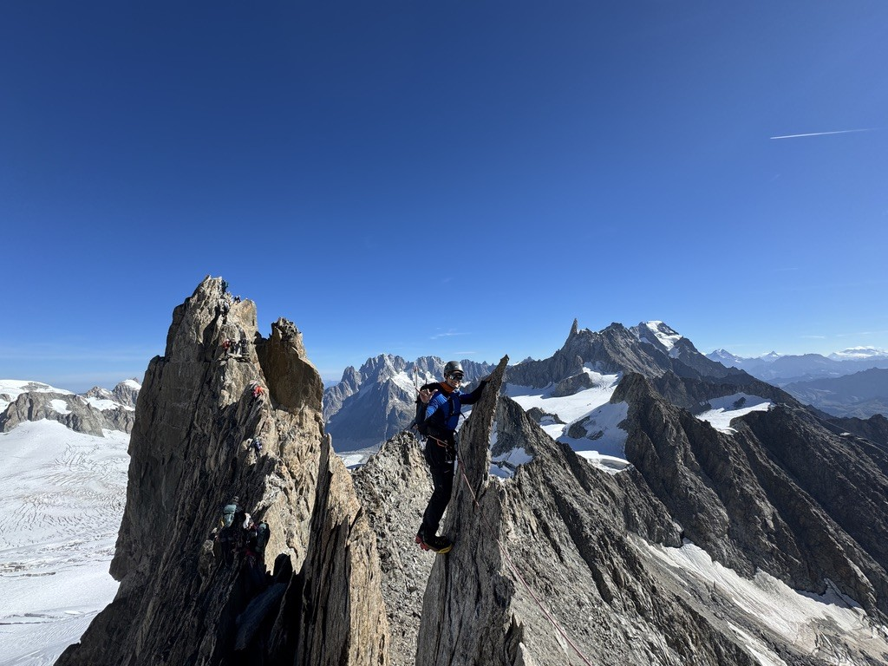
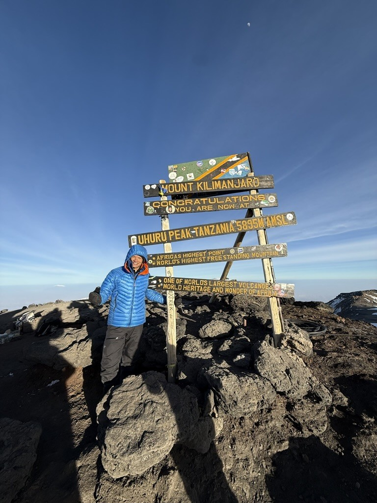

<!--
  To add a photo: put the file in assets/img/outside/ and copy a <figure> block.
  A figure on its own spans the full width. Figures inside 

  share one row at equal height: set --ar on each to its width divided by its height
  (1.333 for a 4:3 landscape photo, 0.75 for a 3:4 portrait one).
-->

## Mountaineering

  <figure class="outside-photo" style="--ar: 1.333">
    
    <figcaption>Traverse of the Aiguilles d'Entrèves, Mont Blanc massif.</figcaption>
  </figure>
  <figure class="outside-photo" style="--ar: 0.75">
    
    <figcaption>Uhuru Peak, Kilimanjaro (5,895 m).</figcaption>
  </figure>

