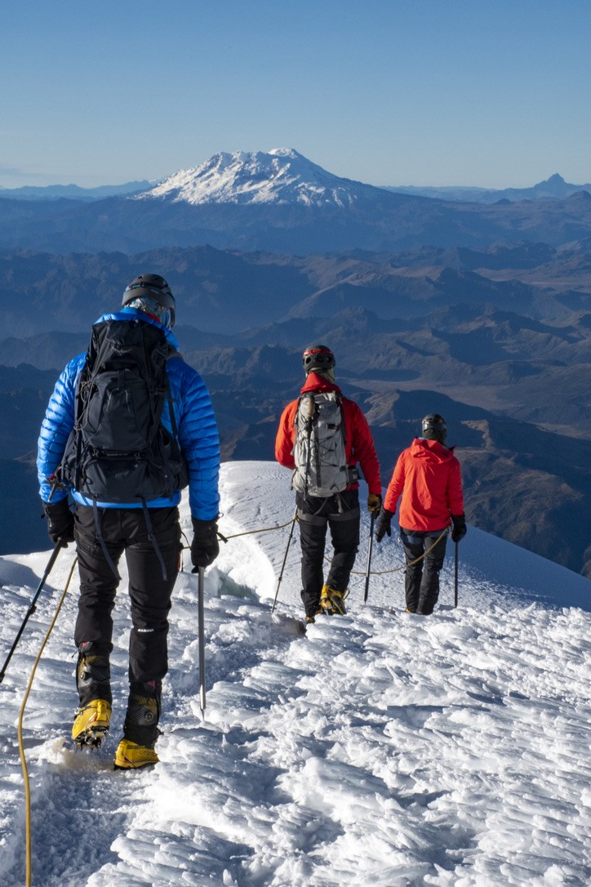
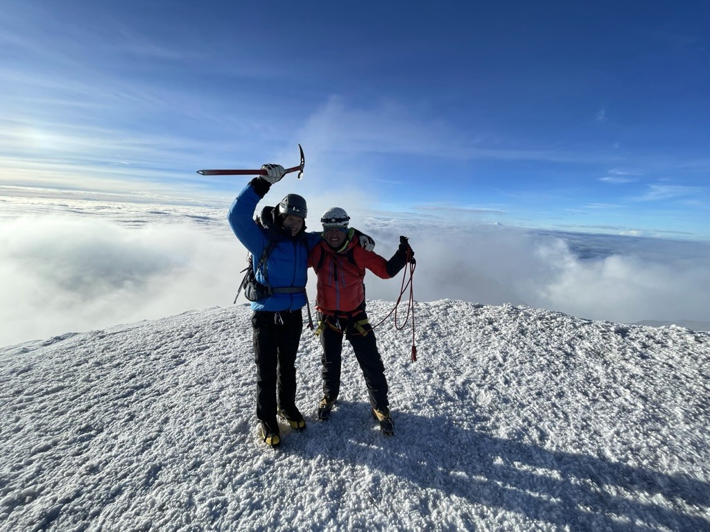
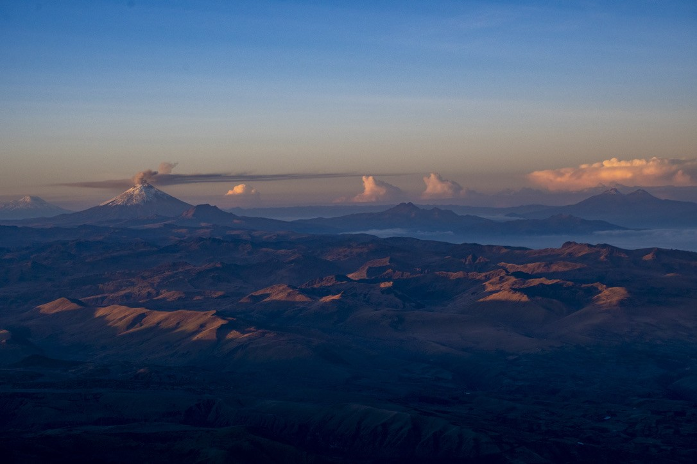
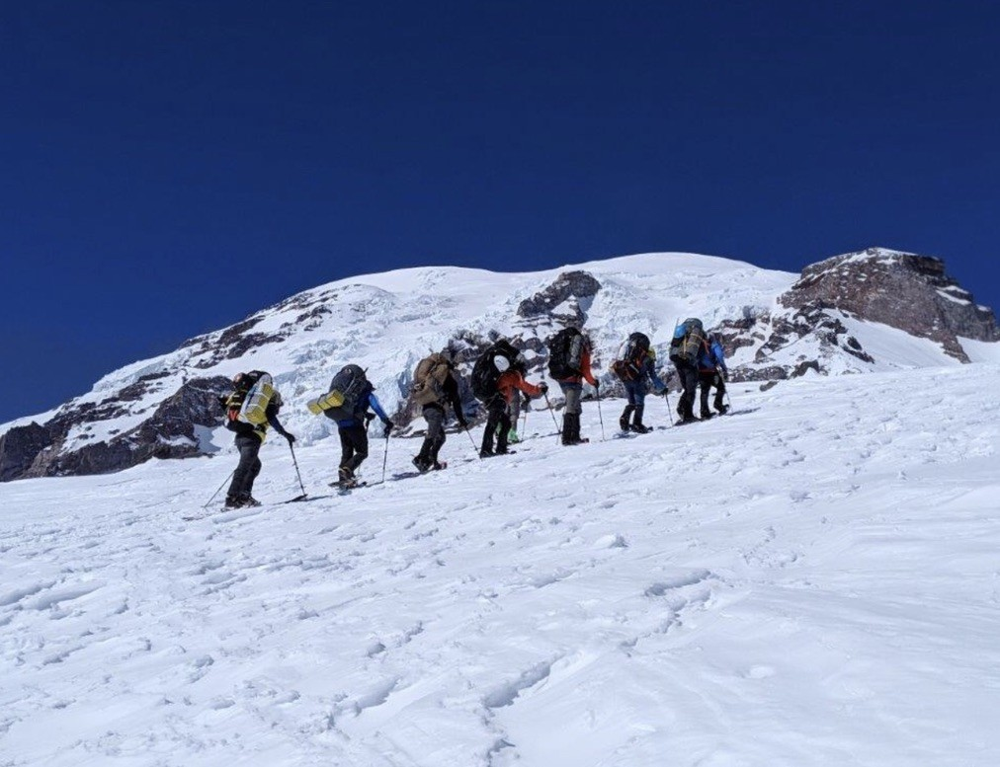
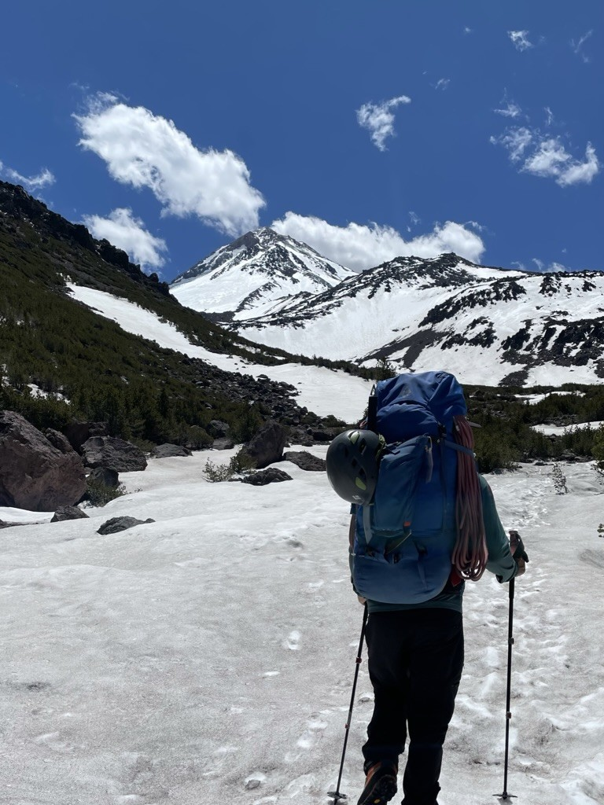


  To add a photo: put the file in assets/img/outside/ and copy a figure block.
  A figure on its own spans the full width. Figures inside a div with class
  "outside-row" share one row at equal height: set --ar on each to its width
  divided by its height (1.333 for a 4:3 landscape photo, 0.75 for a 3:4
  portrait one, 0.667 for 2:3). One landscape plus one portrait fills a row well.


I like to spend time outdoors, in particular anywhere on a mountain. I have also been learning guitar, although it's a long process. I used to compete in Olympic-style weightlifting, including at the USA National Championships in 2024 and 2025.

## Mountaineering

  <figure class="outside-photo" style="--ar: 1.333">
    
    <figcaption>Traverse of the Aiguilles d'Entrèves (3,600 m), Mont Blanc massif.</figcaption>
  </figure>
  <figure class="outside-photo" style="--ar: 0.75">
    
    <figcaption>Uhuru Peak, Kilimanjaro (5,895 m).</figcaption>
  </figure>

  <figure class="outside-photo" style="--ar: 0.667">
    
    <figcaption>Descending from the summit of Cayambe (5,790 m), with Antisana in the background.</figcaption>
  </figure>
  <figure class="outside-photo" style="--ar: 1.333">
    
    <figcaption>Summit of Cotopaxi (5,897 m).</figcaption>
  </figure>

<figure class="outside-photo">
  
  <figcaption>Cotopaxi erupts at sunrise, seen from the bergschrund on Cayambe.</figcaption>
</figure>

  <figure class="outside-photo" style="--ar: 1.302">
    
    <figcaption>Moving up to Camp Muir, Mount Rainier (4,392 m).</figcaption>
  </figure>
  <figure class="outside-photo" style="--ar: 0.75">
    
    <figcaption>On the approach to the north ridge of Mount Shasta (4,322 m).</figcaption>
  </figure>

