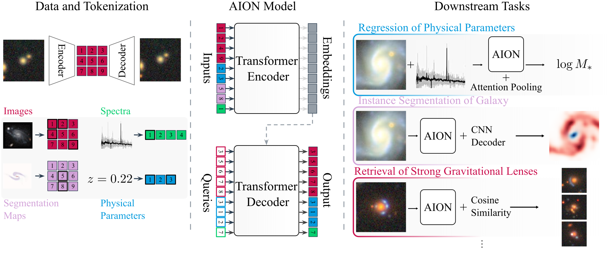
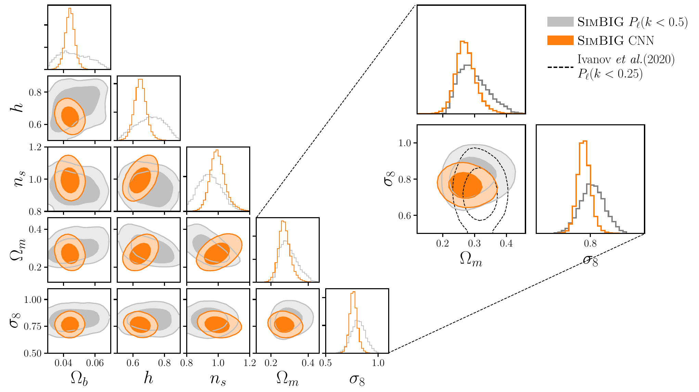

<!-- Each section: an optional figure, a short paragraph, then key papers.
     To add a figure, put it in assets/img/ and copy the <figure class="research-figure"> block below;
     it floats to the right of the text, as on Oliver's page. -->

## Neural field-level BAO reconstruction with DESI

<figure class="research-figure">

</figure>

To constrain dark energy, DESI charts the Universe's expansion history with a standard ruler: baryon acoustic oscillations (BAO), sound waves from the early Universe that left a preferred separation between galaxies. Billions of years of non-linear gravitational evolution have blurred this ruler. Surveys sharpen it by partially reversing the gravitational displacements, but standard reconstruction treats gravity and galaxy bias as linear, and its error analysis is exact only for a Gaussian field, so it has to be calibrated with mock simulations and empirical corrections. My thesis develops the Linear Field Transformer (LiFT), a neural network that performs non-linear BAO reconstruction on real survey data without these assumptions and significantly increases the information recovered from the same galaxies.

Key papers: [Parker et al. 2026](https://arxiv.org/abs/2609.14862), [Parker, Bayer & Seljak 2025](https://arxiv.org/abs/2504.01092), [Bayer, Parker et al. 2026](https://arxiv.org/abs/2603.15732)

## Lightcone Research

*Description to come.*

Code: [ASTRA](https://github.com/LightconeResearch/astra-spec), [Lightcone-CLI](https://github.com/LightconeResearch/lightcone-cli)

## Foundation models for astronomy

<figure class="research-figure">

</figure>

Modern surveys observe the same objects in many ways: images, spectra, photometry, time series. Most analysis is still built one instrument and one task at a time. With collaborators, I have developed methods that combine observations from different surveys in a single model, and pretrained models of up to 7 billion parameters whose learned representations can be reused across tasks with little or no labeled data. Alongside this, we built open data infrastructure, now more than 100 TB, that makes the data from these surveys machine-learning ready.

Key papers: [Parker, Lanusse, Shen et al. 2025](https://arxiv.org/abs/2510.17960), [Multimodal Universe Collaboration 2024](https://arxiv.org/abs/2412.02527), [Parker et al. 2024](https://arxiv.org/abs/2310.03024), [Koblischke, Parker et al. 2026](https://arxiv.org/abs/2512.11982)

## Simulation-based inference of galaxy clustering

<figure class="research-figure">

</figure>

Standard analyses compress a galaxy survey into its two-point statistics, which miss the information on small scales and in the non-Gaussian structure of the map. Simulation-based inference instead trains neural networks on simulated galaxy catalogs that include the survey's geometry and observational effects. With collaborators, I applied this to BOSS galaxies at the field level, and the resulting constraint on σ8 is 2.65 times tighter than a standard power spectrum analysis.

Key papers: [Lemos, Parker et al. 2024](https://arxiv.org/abs/2310.15256), [Hahn, Lemos, Parker et al. 2024](https://arxiv.org/abs/2310.15246)

